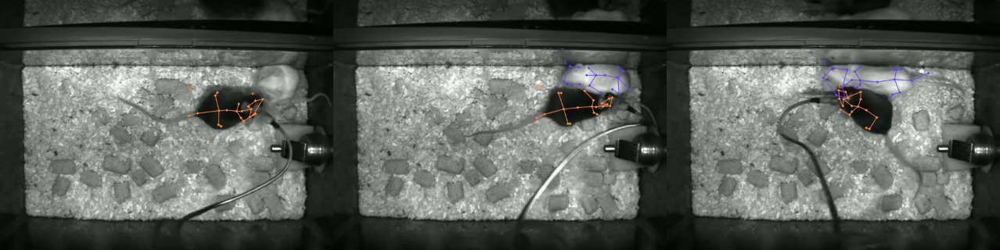

# Animal Pose

Multi-animal pose estimation for rodents, built so one model can serve many species and camera angles.

1. **detect**: find each animal (CenterNet-style, one species-agnostic "animal" class).
2. **pose**: 25 canonical keypoints per animal.
3. **track**: Kalman + Hungarian on IoU, pose and a learned appearance embedding.
4. **refine**: a temporal LSTM smooths jitter and fills gaps.
5. **behavior**: a TCN labels each frame, and a 132-entry catalogue fills in the rest.

It handles one camera at any angle, or a calibrated multi-camera rig triangulated to 3D. It ships as a
PyTorch package (`src/animalpose`) and a pure-Rust binary (`rust/`) that read the same configs and the
same checkpoints.

## Why not DeepLabCut?

DeepLabCut trains one network per project and keypoint set. Here:

- **One vocabulary.** Every dataset maps onto a fixed 25-point quadruped skeleton, and unlabeled points are
  masked out of the loss, so datasets with different keypoints train one network.
- **One head for every species.** Each keypoint is a learned query dotted with a shared feature map.
  Adding a keypoint means appending a query.
- **View-invariant temporal and behavior models.** They work in a normalized, egocentric frame and train
  on poses projected through random cameras.

## Quick start

```bash
git clone <repo> && cd animalpose && git lfs pull      # weights/*_general.pt
pip install -e ".[dev]"
animalpose predict --video my_video.mp4 --out outputs/run   # tracks.csv, behavior.csv, overlay.mp4
```

Or with no Python at all:

```bash
cd rust && cargo build --release
./target/release/animalpose predict --video my_video.mp4 --out outputs/run
```

The desktop app does live tracking from USB cameras, records, and analyzes the recording. On a Mac it
runs the networks on the GPU (Metal):

```bash
cd rust && cargo run --release --features gui --bin animalpose-gui
```

`configs/pipeline.yaml` points at the four general checkpoints in `weights/` (detector, pose, temporal,
behavior). Video input needs `ffmpeg` on `PATH`.

## Fine-tune on your recording

No hand labels needed:

```bash
animalpose data audit my_video.mp4 --out configs/camera.yaml        # blur, noise, animal size
animalpose label --root videos/ --include my_video --boxes blob --range 0 0.8 --no-holdout \
    --out data/processed/my_video                                   # first 80 % of the recording
animalpose finetune pose configs/pose.yaml weights/pose_general.pt \
    data.source=coco data.json=data/processed/my_video/train.json data.camera_profile=configs/camera.yaml
animalpose eval unlabeled --root videos/ --include my_video --all-sources --range 0.8 1.0 \
    --pairs weights/detector_general.pt:weights/pose_general.pt weights/detector_general.pt:runs/pose.pt
animalpose behavior cluster --tracks outputs/run/tracks.npz --video my_video.mp4 --out outputs/run/clusters
```

`label` keeps only confident detections and keypoints that agree under a mirror flip.
`eval unlabeled` compares the general and fine-tuned models on the last 20 %, which was never trained
on: detection rate, flip agreement, jitter and confidence. DeepLabCut projects convert with `animalpose data convert`; multi-camera rigs calibrate
with `animalpose data calibrate` and run with `predict --views a.mp4 b.mp4 --cameras cams.json`.

## Results (held-out public data)

Training data: CRIM13, Rat 7M and mirror-mouse train splits (CC BY 4.0), plus the simulator.

| Set | View | Pose PCK@0.1 | Detection AP50 |
|---|---|---|---|
| CRIM13 (new sessions), 2 mice | top | 0.89 | 0.91 |
| Rat 7M (time-disjoint), 6 cameras | side, 8–32° | 0.97 | 0.99 |
| mirror-mouse (new animals) | side | 0.94 | 1.00 |
| mirror-mouse (new animals) | bottom | 1.00 | 0.98 |

- **3D, Rat 7M vs motion capture:** 13.5 mm MPJPE, 9.0 mm median (rat ≈ 200 mm).
- **Two-mouse tracking, CRIM13:** identity purity 0.90, 3 swaps over 4 × 1,200 frames.
- **Side-view paws:** left/right PCK 0.91 from one view, 0.97 with a second view.
- **Occlusion:** keypoint confidence separates visible from hidden points (AUROC 0.985).

Models trained on the simulator alone score near zero on real video, so real data is what drives these
numbers.



*Hollow points were filled in by the temporal model. CRIM13 by Burgos-Artizzu et al., distributed by
Lightning Pose under CC BY 4.0.*

## Rust

`rust/` is a dependency-light port: no PyTorch, no OpenCV, no C toolchain. It loads `.pt` and
`.safetensors` checkpoints directly, reads the same YAML configs, and writes the same outputs. Its tests
pin it to the Python reference (keypoints within 1e-3 px on the pipeline fixture). See
[rust/README.md](rust/README.md).

## Layout

| Path | Contents |
|---|---|
| `src/animalpose/` | Python package: `skeleton`, `detector`, `pose`, `tracking`, `temporal`, `behavior`, `multiview`, `data`, `eval`, `export`, `cli` |
| `rust/` | the Rust port and its tests |
| `configs/` | the inference pipeline and the synthetic training recipes; configs inherit with `extends:` |
| `weights/` | the four general checkpoints (git-lfs) |
| `tests/` | the Python suite plus the torch fixtures the Rust tests check against |

```bash
pytest                       # Python suite
cd rust && cargo test        # Rust suite
```

## Next steps

- Side-view paws when the far legs are hidden: about 10 % of separated pairs still swap.
- Behavior needs more human-labeled real data, especially rearing and grooming.
- Zero-shot tests on new species (iRodent, AP-10K).
- Score tracking identity against human labels instead of a coat-brightness proxy.

## License

MIT. Datasets and pretrained weights you download carry their own licenses, some non-commercial.
