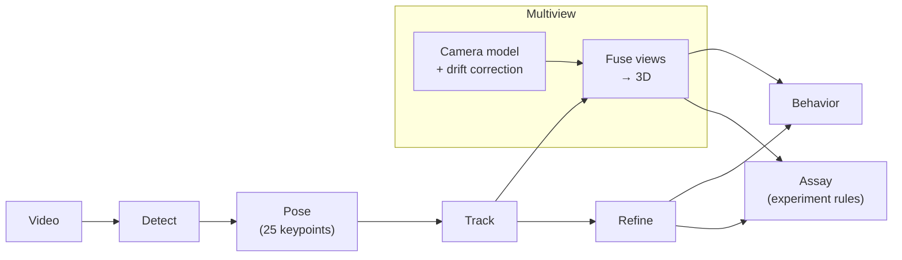

<p align="center">
  <a href="https://github.com/MarkSong535/animalpose">
    
  </a>
</p>

Multi-animal rodent pose estimation across species and camera angles, from one camera or a calibrated
rig, with behavior scoring for standard experiments. A Python package and a pure-Rust CLI and desktop
app share one set of configs and checkpoints.



A shared 25-keypoint skeleton lets datasets with different annotations train one model: CenterNet-style
detection, top-down pose, Kalman + Hungarian tracking, LSTM refinement and TCN behavior classification.

## Install and run

Needs FFmpeg (`ffmpeg`, `ffprobe`) for video and Git LFS for the general weights in `weights/`.

```bash
git lfs pull
pip install animalpose                                     # Python 3.10+; from a checkout: pip install -e ".[dev]"
animalpose predict --video myvideo.mp4 --out outputs/run
```

Rust (no Python or PyTorch; reads `.pt` and `.safetensors` directly):

```bash
cd rust && cargo build --release
./target/release/animalpose predict --video ../myvideo.mp4 --out ../outputs/run
```

Desktop apps share `~/AnimalPose` (models, configs, profiles, camera models, settings):

```bash
cd rust && cargo run --release --features gui --bin animalpose-gui    # Windows, Linux, macOS (egui)
cd macos && ./build-app.sh && open build/AnimalPose.app                # native macOS app (SwiftUI)
```

macOS means Apple Silicon (no Intel Macs). The macOS app needs Rust and Xcode (Swift 6) to build and
runs on macOS 14+; Liquid Glass needs Xcode 26 and macOS 26. Prebuilt CLI, apps (`.dmg`, `.exe`, `.deb`,
`.rpm`) and the models zip are on GitHub Releases: extract `animalpose-models-v<version>.zip` into
`~/.animalpose`.

## Using the app

The sidebar has **Process**, **Live**, the **Profile** in use and recent **Results**. Status messages
fade after 5 seconds (hover to keep one).

- **Profiles** (Settings → Profiles) bundle a config, the models, the recording stages, the camera
  model and camera names. Switch from the sidebar; right-click a profile to **Duplicate** or **Delete**.
  The sample profiles in `samples/` (with their networks and camera models) install on first launch.
- **Live**: select cameras and press **Preview**. Each tile's label ("Camera 1", "Camera 2", …) is
  editable and becomes the clip's name, so processing knows which view is which. **Timed** (red)
  records the profile's stages (e.g. Accustomization, then Experiment; **Wait for Continue** splits a
  pause into its own clip); **Record** runs until **Stop**. Clips go to `~/AnimalPose/recordings`, one
  MP4 per camera per stage, with `session.json` listing views, frame counts and capture times.
  **Analyze Recording** processes the last session in place.
- **Process**: drop videos or folders, pick the output folder, press **Process**. One video gives
  `<name>-analysis/`; several give `animalpose-batch-…/` with `batch.json`. Pause, resume and stop keep
  finished work.
- **Multiview** (Process): choose a camera model in the profile (Import… a `cams.json`). Each folder's
  videos are matched to cameras by name or number and fused into 3D.
- **Experiments**: Settings → Configs → Experiment picks open field, plus maze, three chamber or
  grooming; results gain an `assay/` folder. Adding a setup needs no code: see
  [docs/new_experiment.md](docs/new_experiment.md).
- **Configs** edits thresholds, tracking, smoothing, behavior, camera drift and experiment rules;
  the shipped pipeline is read-only, duplicate it to edit.

Recording has priority over analysis: frames queue in order and capture waits rather than drops;
cameras are free-running (no hardware sync). Apple Silicon runs the networks on Metal (~6× the CPU).

## Command line

Python (`animalpose …`) and Rust (`rust/target/release/animalpose …`) take the same commands.

| Command | What it does |
|---|---|
| `predict` | `--video` (file or frame folder), `--views` + `--cameras` for 3D, or `--synthetic` |
| `train`, `finetune` | detector, pose, temporal and behavior networks |
| `label` | pseudo-label unlabeled recordings |
| `behavior` | `cluster`, `name`, `label`, `plot` |
| `assay` | rerun experiment rules on finished analyses, no networks (Rust) |
| `data` | `audit`, `calibrate` (camera model from landmarks), `convert`, `prepare`, `download` |
| `eval` | metrics and benchmarks (AP, PCK, MOTA/IDF1, F1) |
| `export` | `safetensors`, `import-safetensors` (Python also ONNX / TorchScript) |

## Configs

`configs/pipeline.yaml` is the default; a config may `extends:` another, and any key can be overridden
by trailing dotted arguments (`animalpose predict … pipeline.det_thresh=0.4 drift.enabled=false`).

| Block | Sets |
|---|---|
| `checkpoints` | detector, pose, temporal, behavior (`checksums:` verifies SHA-256 before loading) |
| `pipeline`, `tracker` | detection, pose, background, tracking and smoothing |
| `drift` | how multiview cameras are re-registered each session (below) |
| `assay` | experiment, arena and rule thresholds; every key at its default in `configs/assay_example.yaml` |

**Camera drift.** A calibration holds while cameras stay put. Before each fusion, every camera's
median background is registered against its reference picture (`<model>.references/<camera>.png`,
taken from the first session fused with that model): a coarse-to-fine alignment over the camera's
rotation through its own lens model, with lighting gain/offset and robust weights so moved objects
count less than walls and desk. The rotation is applied when it improves the agreement; nothing caps
how far a camera may move. Results go to `camera_drift.json`. Delete the folder to take a new
reference; a camera moved to another place needs a new calibration.

## Outputs

| File | Contents |
|---|---|
| `tracks.csv`, `tracks.npz` | a row per frame, track and keypoint: x, y, confidence, behavior (npz adds boxes) |
| `behavior.csv`, `overlay.mp4`, `timing.json` | behavior classes, rendered video, frame times |
| `animals3d.npz`, `view<N>_tracks.csv` | multiview: 3D keypoints, reprojection error, per-view tracks |
| `views.json`, `cameras.json`, `camera_drift.json` | which video is which camera, cameras used, drift |
| `assay/behavior_v3.csv`, `behavior_summary_v3.csv` | per-frame states and per-session measures |


## Development

| Path | Contents |
|---|---|
| `src/animalpose/` | Python reference: models, training, pipeline, multiview, CLI |
| `rust/src/` | `tensor`, `models`, `algos`, `data`, `multiview`, `assay`, `eval`, `cli`, `app` (shared engine), `gui`, `ffi` |
| `macos/` | SwiftUI app over the engine's C interface (`rust/src/ffi.rs`) |
| `configs/`, `weights/`, `samples/` | configs and arenas, the four general checkpoints, bundled sample profiles |

```bash
pytest -q -m "not slow"                       # Python; CI also runs the slow tests with coverage
ruff check src tests
cd rust && cargo fmt --all -- --check && cargo clippy --all-targets -- -D warnings && cargo test
cargo test --release --features gui           # app, GUI and Metal (macOS)
cargo clippy --features ffi --all-targets -- -D warnings
```

Python is the reference: Rust tests compare against torch/NumPy dumps in `tests/fixtures` (networks
within 5e-5, pipeline keypoints within 1e-3 px, checkpoints bit-exact), and intentional differences
are marked `// differs from Python:`. Rust features: `app` (engine), `gui` (egui window, includes
`mps`), `ffi` (static library for the macOS app), `mps` (Metal). `rust-toolchain.toml` pins 1.100.0;
the minimum supported Rust is 1.77. Rebuild the sample profiles with `scripts/build_samples.py`, and
the app icons (macOS `.icns`, window `.png`, Windows `.ico`) from `docs/icons/minimal.svg` with
`scripts/make_icons.sh` (macOS).
Releases: **Actions → Release → Run workflow** builds and tests every package; a `v1.0.0`-style tag
publishes them to GitHub Releases and PyPI (trusted publisher: `release.yml`, environment `pypi`).

## License

GPL-3.0-only. Datasets and pretrained weights may have separate licenses.
